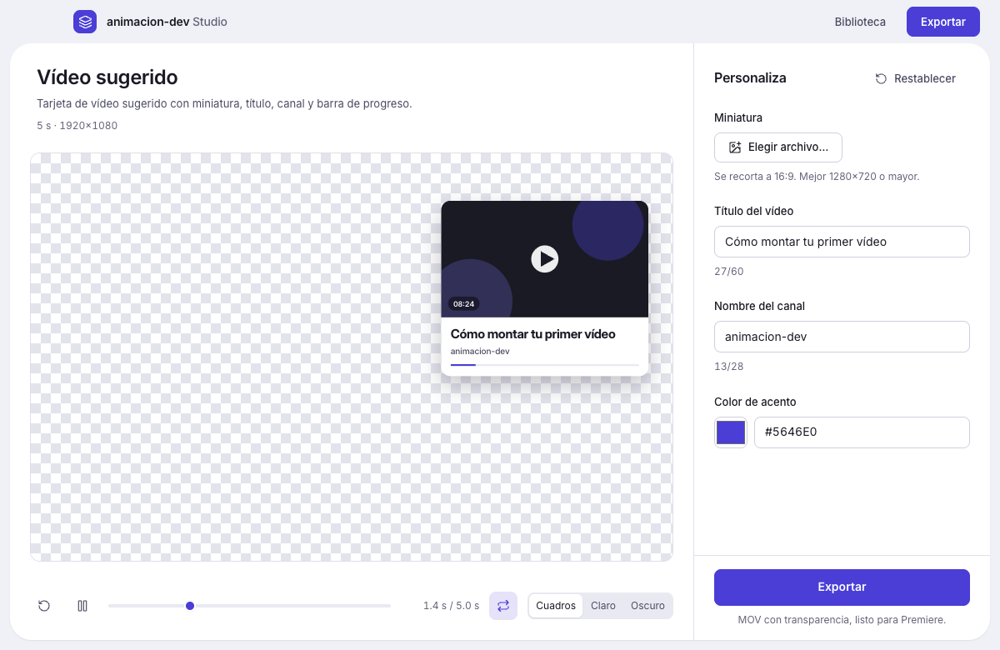

# animacion-dev Studio

App de escritorio para **personalizar animaciones de HyperFrames y exportarlas
listas para poner encima de un vídeo**. Pensada para alguien que edita vídeo pero
no programa: abre una plantilla, cambia unos campos (un texto, una foto, un
color), mira la vista previa y pulsa **Exportar**.

- **Salida por defecto:** MOV **ProRes 4444 con canal alfa** (fondo transparente),
  listo para Premiere.
- **Todo en local.** Sin servidor, sin cuenta, sin IA, sin internet. El render
  ocurre en el equipo del usuario.
- **No** es un editor de animaciones: no hay timeline ni se crean composiciones.
  Solo reproduce y exporta composiciones de HyperFrames ya hechas.



## Qué hace

| Pantalla | Para qué |
|---|---|
| **Biblioteca** | Rejilla de plantillas con miniatura. Se añaden **arrastrando** una carpeta (o un `.zip`) sobre la ventana. |
| **Plantilla** | Vista previa grande (con cuadros para ver la transparencia) + formulario autogenerado. Los cambios se ven en vivo. |
| **Exportar** | Elige carpeta, nombre y formato. Progreso real, cancelable, y cola de exportaciones. |

Los valores que escribes se **guardan por plantilla**: al reabrirla está todo como
lo dejaste (y hay un botón para restablecer).

## Formatos de exportación

| Formato | Transparencia | Para qué |
|---|---|---|
| **MOV · ProRes 4444** | Sí | Premiere, edición. Es el de por defecto. |
| **WebM · VP9** | Sí | Archivos mucho más ligeros. |
| **Secuencia PNG (RGBA)** | Sí | After Effects, Nuke, Fusion. |
| **MP4 (H.264)** | No | Cuando no hace falta transparencia. |

> La transparencia depende de la composición, no de un ajuste: si la animación
> pinta un fondo opaco, saldrá opaco. Las plantillas para superponer se autorizan
> sin fondo.

## Instalar

Descarga el instalador de la última release:

- **macOS**: `.dmg` (arm64). Arrastra a Aplicaciones.
- **Windows 11**: `.exe` (NSIS) o `.msi` (x64).

La app **no necesita** Node, Chrome ni ffmpeg instalados: lleva dentro sus propios
componentes. En cambio, ocupa bastante (el navegador del render pesa ~190 MB), y
por eso el instalador ronda los **278 MB** (macOS arm64).

⚠️ **Aún sin firmar**: macOS mostrará un aviso de Gatekeeper y Windows un aviso de
SmartScreen. Ver [`docs/SIGNING.md`](docs/SIGNING.md) para qué significa y cómo
quitarlo.

## Formato de plantilla

Una plantilla es una **carpeta**:

```
mi-plantilla/
  index.html      # composición HyperFrames, con data-composition-variables
  template.json   # manifiesto para la app
  assets/         # fuentes, imágenes, gsap…
  thumb.png       # opcional; si no está, la app genera un fotograma
```

`template.json` (esquema v1):

```json
{
  "schemaVersion": 1,
  "id": "boton-suscribirse",
  "name": "Botón de suscribirse",
  "description": "Botón con contador de subs",
  "version": "1.0.0",
  "duration": 4,
  "resolution": "landscape",
  "fields": [
    { "id": "subs",   "type": "text",  "label": "Suscriptores", "default": "12,4 K", "maxLength": 12 },
    { "id": "avatar", "type": "image", "label": "Foto del canal", "accept": ["png","jpg","webp"] },
    { "id": "accent", "type": "color", "label": "Color de acento", "default": "#D9381E" }
  ]
}
```

Reglas:

- Cada `fields[].id` debe existir como variable en
  `data-composition-variables` del `index.html`. La app **avisa** (no bloquea) de
  discrepancias al importar.
- Tipos v1: `text`, `image`, `video`, `color`. El esquema acepta ya `number`,
  `select` y `toggle` (se muestran como texto en esta versión).
- Los campos de imagen/vídeo se copian a una carpeta de trabajo y se pasan como
  **ruta relativa** (`media/<campo>.<ext>`), que es el contrato documentado de
  HyperFrames.

Hay dos plantillas de ejemplo en [`templates/`](templates/) que la app instala
sola la primera vez.

## Desarrollo

```bash
npm install
npm run sidecars      # copia el runtime y descarga chrome-headless-shell (~190 MB)
npm run dev           # arranca la app
```

| Comando | Qué hace |
|---|---|
| `npm run dev` | App en modo desarrollo (HMR). |
| `npm run build` | Compila main, preload y renderer a `out/`. |
| `npm run typecheck` | Tipa el proceso principal y el renderer. |
| `npm test` | Pruebas de integración **dentro de Electron** (biblioteca, validación, preview, render). |
| `npm run debug:preview` | Capturas de la vista previa en varios instantes, para revisarla a ojo. |
| `npm run bench:startup` | Mide el arranque en frío. |
| `npm run dist:mac` / `dist:win` | Instalador de la plataforma actual. |

`npm run sidecars` acepta variables para builds cruzados:

- `CHROME_PLATFORM=mac_arm,mac` — prepara varias arquitecturas.
- `KEEP_PLATFORMS=darwin/arm64,darwin/x64` — qué binarios de ffprobe se conservan.
- `SKIP_CHROME=1` — no descarga el navegador (útil en CI de verificación).

## Documentación

- [`docs/ARCHITECTURE.md`](docs/ARCHITECTURE.md) — cómo está montado y por qué.
- [`docs/PHASE0-SPIKE.md`](docs/PHASE0-SPIKE.md) — decisiones tomadas con datos.
- [`docs/SIGNING.md`](docs/SIGNING.md) — firma, Gatekeeper y SmartScreen.

## Límites conocidos (v1)

- Sin autoactualización, sin catálogo remoto, sin editor de plantillas, sin IA.
- Sin soporte de Linux (el código es portable, pero no se distribuye).
- Windows 11 x64 es el objetivo en Windows; macOS 14+ en Mac (arm64).
- **Verificado**: la exportación MOV con alpha funciona desde el paquete, con
  entorno vacío, en macOS; CI compila, empaqueta y valida los componentes en
  Windows 11 (NSIS + MSI).
- **Pendiente**: abrir la app y exportar en un Windows 11 de escritorio real, y
  confirmar la importación del MOV en Premiere. Ver el detalle de qué está probado
  y qué no en [`docs/PHASE0-SPIKE.md`](docs/PHASE0-SPIKE.md).
